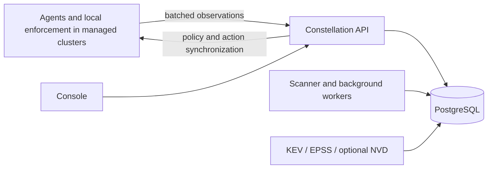
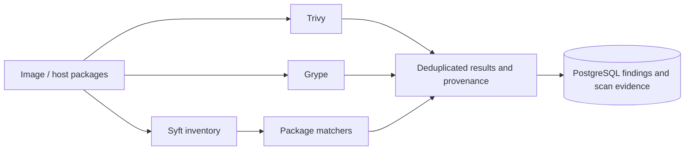
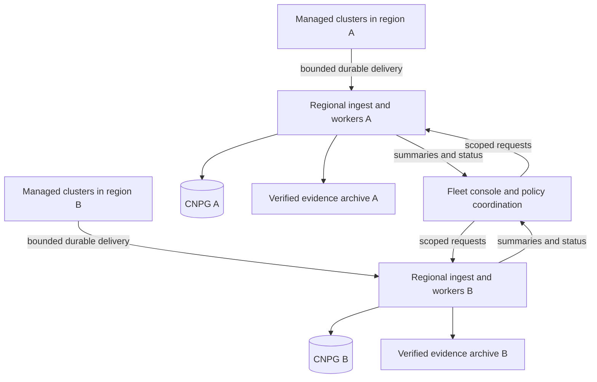

# Architecture

Architecture snapshot originally reviewed October 11, 2026; delivery and database
status below reconciled October 26. The [current readiness plan](readiness-and-parity-plan.md)
owns acceptance status. This document distinguishes source
behavior from the proposed fleet topology; neither a diagram nor the existence
of federation APIs establishes production scale or disconnected operation.

## Current implementation

Constellation is a central control plane with cluster-scoped enrollment and
node-local runtime agents. Agents supervise the native DP/DPI subsystem,
collect runtime observations, and upload batches to authenticated API endpoints.
Kubernetes/CNI policy and node-local enforcement are distinct from telemetry
storage. Their full enforcement, workload scoping and outage/restart behavior
remain subject to the readiness plan's supported-profile acceptance criteria.

Runtime events and raw flows use time-partitioned PostgreSQL tables. Flows also
have hourly aggregates and a live graph cache. Scan jobs and workers use
PostgreSQL; settings, identity, findings and the transactional audit chain also
reside there. Some work can run concurrently across API/worker replicas, but
rollup state and the control-audit chain each have a shared serialization point.
Time partitioning enables pruning; it is not horizontal write sharding.

Receipt-aware event/flow producers use bounded durable node-local spools and
producer/sequence receipts. The API commits raw rows and replay state atomically,
acknowledges after commit, and uses pgx batches for inserts. Legacy producers and
other telemetry lanes have different loss boundaries; node/disk loss can destroy
unacknowledged evidence. Response callbacks, notifications and graph updates are
not a transactional delivery outbox. See the [delivery contract](telemetry-delivery.md)
for bounds, retries, replay guarantees and remaining gaps.

Source anchors: `cmd/constellation-runtime-agent/main.go`,
`internal/handler/runtime/events_ingest.go`,
`internal/handler/netpolicy/network_flows_ingest.go`,
`internal/flowrollup/fold.go`, `pkg/audit/audit.go`, and `pkg/federation/`.
Federation membership/policy primitives exist, but capacity isolation, regional
routing and a complete federated query contract are not thereby established.

The managed database is CNPG; external PostgreSQL remains supported. The last
recorded live observation, October 23, found one healthy CNPG instance at migration
190 with successful WAL archiving and a completed scheduled backup. This was not
remeasured October 26, and does not establish HA/off-host recovery. Source reviewed
October 26 requires migration 198. See [database recovery](cnpg-recovery.md) and
the [database lifecycle assessment](database-lifecycle-backlog.md).

## Active vulnerability and scanning pipeline

Syft supplies package inventory. Trivy and Grype provide active vulnerability
matching; their scanner databases are replaceable caches. The API's PostgreSQL
`cve_records` catalog is fed by KEV/EPSS and optional NVD. The sibling
`constellation-vulndb` producer and its bundle/bbolt importer are retired and
are not prerequisites for this architecture. Legacy field/type names may remain
in code or historical migrations; they do not describe the active producer.

`internal/scanner/aggregator.go` configures the active engines and package
matchers. `internal/handler/findings/cve_intel_import.go`, `nvd_import.go`, and
`cve_records_writer.go` own the API catalog. Conditional writes and bounded
persistent feed checkpoints now avoid unchanged imports across restarts; see
[checkpoint semantics and evidence](cve-feed-checkpoints.md). DB-18 real-feed/live
qualification remains open. Moving the catalog to a second PostgreSQL database
would not reduce its data volume.

## Proposed fleet topology — qualification work, not deployed behavior

Preserve local enforcement and make each cluster's telemetry delivery resilient
to WAN/control-plane failure. Begin by qualifying one bounded control-plane
deployment, then use multiple independent deployments serving assigned groups
of clusters when capacity, geography or failure isolation requires it. A
regional deployment is a useful boundary; a dedicated database in every managed
cluster is not required by this proposal.

Required contracts before calling this fleet-ready:

1. **Local continuity:** preserve the last valid policy under WAN failure and
   define freshness, revocation and restart behavior. Test each enforcement
   backend; do not assume a live in-memory policy survives an agent restart.
2. **Durable bounded ingest:** producer IDs/sequences, authenticated cluster
   binding, idempotent replay, acknowledgement after durable acceptance,
   capped/encrypted local spool, retry/backoff including 429/Retry-After, and
   explicit overflow priorities/drop counters. Critical receipts and ordinary
   telemetry need separate durability/priority contracts. A finite spool cannot
   promise lossless delivery through an arbitrarily long outage.
3. **Fair resource use:** per-cluster/tenant byte and row quotas, fair worker
   scheduling, bounded DB connections, and incremental processing. Benchmark
   bulk SQL/COPY with existing validation, audit and atomicity guarantees intact.
   A noisy cluster must not monopolize ingestion, fold progress or foreground
   query capacity; a tenant hold must have an explicit storage budget.
4. **Scoped progress and storage:** evolve global rollup watermarks into safely
   partitionable work ownership only with replay/count-preservation tests. Keep
   transactional control audit correct; any per-tenant chain or archive-anchor
   transition needs a versioned integrity/migration design. Do not replace a
   global lock with per-cluster locks while retaining one shared mutable state.
5. **Bounded fleet coordination:** authenticate regional assignment, preserve
   tenant/cluster scope, define policy revision/acknowledgement/conflict rules,
   and show stale/partial results when a region is unavailable. Aggregate
   summaries and bounded queries at fleet level; avoid requiring all raw
   telemetry to be copied into another global database. Moving a cluster between
   deployments must preserve query history, producer replay and audit ownership.
6. **Measured expansion thresholds:** publish sustainable ingest and query
   capacity for a specified CPU/RAM/IO budget, workload mix and retention policy.
   Exercise skew, duplicate/lost acknowledgements, link loss, spool saturation,
   worker failures, backups and one unavailable regional deployment. A large
   number of almost-idle cluster registrations is not a throughput test.

CNPG replication improves availability and can offload eligible reads, but
writes still go to a primary. It is not automatic horizontal write sharding
([CNPG architecture](https://cloudnative-pg.io/docs/1.25/architecture/)).
Keep PostgreSQL for current control and measured hot-history workloads. Evaluate
separate analytical storage or a broker only against measured workload and
replay needs; do not add them solely to resemble a reference stack. Object
storage for verified cold evidence has a different purpose from hot queries
or a durable ingest acknowledgement.

### Streaming delivery versus analytical storage

These are separate requirements. A durable buffer/log absorbs outages and
bursts and permits replay. An analytical database serves large retained-event
queries. Neither replaces the other, and changing the query database does not
repair a dropping producer or an ambiguous acknowledgement.

| Responsibility | Initial target | Expansion decision |
| --- | --- | --- |
| Identity, configuration, policy, current findings, scan workflow/results and transactional control audit | PostgreSQL/CNPG | Keep transactional authority here; evolve archival and integrity independently. |
| Cluster delivery and replay | Bounded durable local spool, idempotent API acceptance and fair workers | Evaluate a shared durable log/broker when independent consumers, backlog size, retention or replay need it. No broker is selected or deployed by this document. |
| Recent raw telemetry and aggregates | Partitioned PostgreSQL with measured batch-write/query budgets | Benchmark ClickHouse or another analytical store when sustained ingest/retention/analytical queries exceed the qualified cost/latency envelope or materially interfere with control-plane work. |
| Cold evidence, exports and recovery objects | Verified object storage | Require checksums, retention/hold, custody and independent restore; local RustFS remains a test target. |

ClickHouse is a candidate because telemetry commonly requires compression and
column-oriented aggregation ([observability design](https://github.com/ClickHouse/clickhouse-docs/blob/main/docs/use-cases/observability/build-your-own/introduction.md)).
It is not selected, and the current roughly 9-GB live database does not by itself
justify a migration. A distributed streaming log such as Kafka provides durable
records and independent replayable consumption
([Kafka introduction](https://kafka.apache.org/documentation/)); that is a
different decision from the query engine. Do not interpret these examples as
adding mandatory services to the initial deployment.

Benchmark the expected busy-cluster workload before a fleet commitment. Record
rows/bytes per second, burst duration, hot retention, index/column cardinality,
query concurrency and p95/p99, backlog recovery time, cost and operator burden.
Separate a payload's durable acceptance from its eventual appearance in derived
queries. If adding another consumer/store, use replayable idempotent processing
and, where transactional business changes publish events, an outbox or equivalent
atomic handoff. Avoid uncoordinated synchronous dual writes. Test duplicate
delivery, late data, deletion/hold propagation, scope isolation, schema changes,
store outages and full rebuild before moving query authority. Local enforcement
must not depend on the analytical store being online.

## NeuVector comparison

NeuVector's documented federation keeps controllers in each managed cluster,
coordinates federated policy and selected registry results, and lets the
console manage remote clusters. That distributes cluster-local work and
failure domains instead of requiring one fleet-wide raw-history database
([multi-cluster documentation](https://open-docs.neuvector.com/navigation/multicluster/)).

Its production documentation recommends multiple controllers, persists
configuration and registry results via its volume configuration, and directs
operators to external syslog for log retention
([production deployment](https://open-docs.neuvector.com/deploying/production/)).
In the inspected source revision `24abda1f483672c73854af8ba65d4ac12f67e163`,
`controller/cache/log.go` uses separate 4,096-entry console-history caches;
`share/cluster/eventqueue.go` bounds producer queues; `db/models.go` has separate
replaceable SQLite CVE and vulnerability-asset stores. These are specific
mechanisms, not a claim that all NeuVector data shares a 4,096-row limit.

Constellation intentionally retains more searchable history and an integrity
chain. Its storage footprint cannot be compared with NeuVector's bounded
console history without also counting the external logging system and aligning
retention guarantees. Reuse the local-work/federation separation principle;
preserve Constellation's stronger evidence goals with explicit costs and tests.

### Scan Schema Baseline (v1)

This is the canonical, frozen baseline for the scan domain as of migration `092`.
It is documentation, not a migration: the tables already exist in the migration
chain (`internal/server/database/migrations/`) and are NOT being rewritten here. The point is to make
future churn visible against a written baseline. The scan domain has historically
been the churniest part of the schema (`scan_jobs` accreted ALTERs across
`008,028,034,054,057,062,066,081,084`; `image_scan_artifacts` created in `068`
then ALTERed in `069–072`), and it overlaps the largest handler files, so any
further column add/drop in these tables should be reviewed against this list
before merge.

`scan_jobs` (control-plane → scanner-worker queue) canonical columns:

- Identity/ownership: `id`, `org_id`, `image_ref`, `platform`, `requested_by`.
- Lifecycle: `status` (`pending|running|completed|failed|paused|canceled`),
  `worker_id`, `error`, `requested_at`, `claimed_at`, `finished_at`,
  `paused_at`, `canceled_at`, `resumed_at`.
- Retry accounting: `attempt_count`, `max_attempts`, `next_attempt_at`,
  `last_attempt_at`, `next_retry_at`.
- Result rollups: `package_count`, `finding_count`.
- Provenance/bundle: `bundle_metadata` (JSONB), `vulndb_bundle_version`,
  `trust_policy_id`.
- Targeting: `target_id`, `scan_target_id`, `target_type`, `target_ref`,
  `target_cluster_id`.

`image_scan_artifacts` (per-scan result rows: SBOM/secret/signature/layer/
file-risk artifacts) is the sibling churn hotspot; its base table is `068` and the
artifact-type tables live in `069–072`. Its FK/constraint set is rebuilt
defensively (drop-if-exists then re-add) in those migrations, which is the
mechanical source of the high ALTER count — not genuine schema redesign.

Gate: changes to `scan_jobs` / `image_scan_artifacts` columns or constraints
require review against this baseline. Prefer new sibling tables over more ALTERs
on these two.
